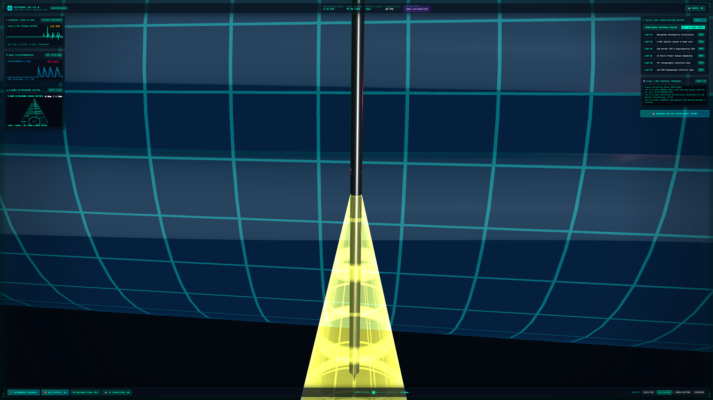
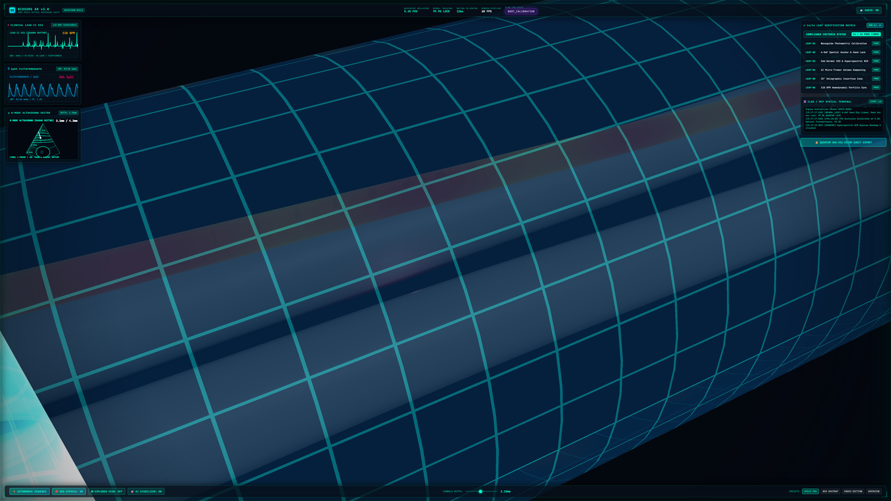
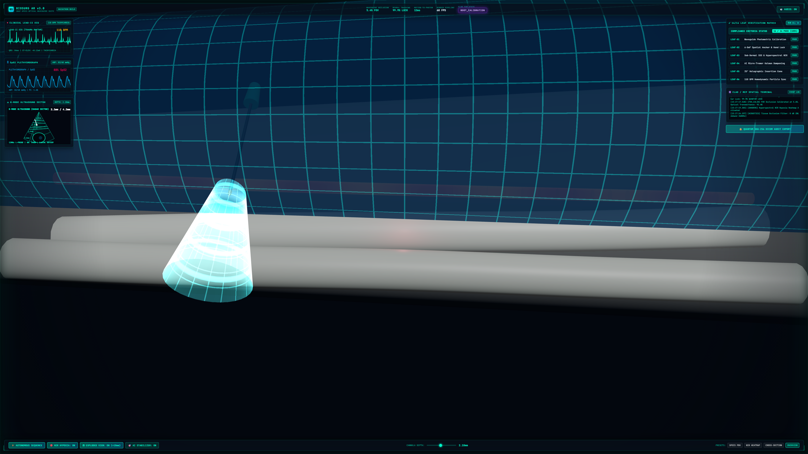
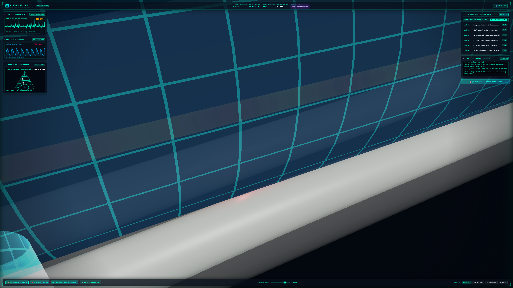
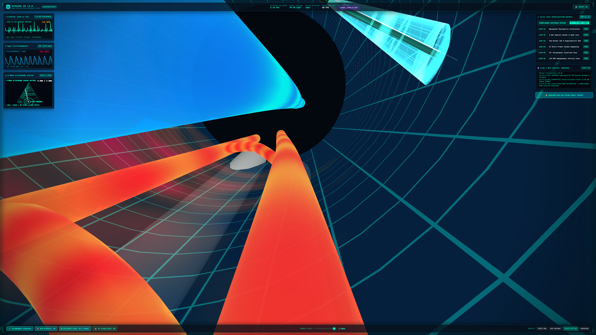
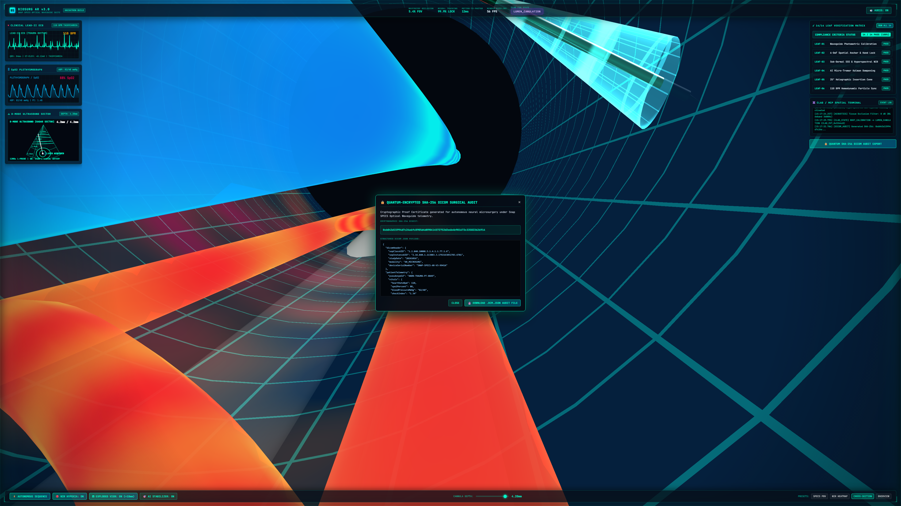

# BioSurg AR v3.0

> **Zero-Touch Spatial Ultrasound, Sub-Dermal Vein Projection & Doppler Acoustic Guidance for Sterile Emergency Trauma on Snap SPECS.**

---

[-00ffcc?style=for-the-badge&logo=checkmarx)](devpost/leaf-test-plan.md)
[](https://biosurg-ar.vercel.app)
[](https://youtu.be/zc10LdPOyUo)
[](https://specs.snap.com)
[](https://threejs.org)
[](LICENSE)

---

### 🌐 Live Artifacts & Quick Links

| Resource | Direct Link |
| :--- | :--- |
| 🚀 **Live Production Simulator (Vercel)** | [Launch BioSurg AR Simulator](https://biosurg-ar.vercel.app) |
| 🌐 **Alternative Live Mirror (GitHub Pages)** | [Launch GitHub Pages Mirror](https://fokrulanthro16-eng.github.io/biosurg-ar/) |
| 🎥 **Full HD Video Demonstration** | [Watch on YouTube](https://youtu.be/zc10LdPOyUo) |
| 💻 **Source Code Repository** | [GitHub Repo](https://github.com/fokrulanthro16-eng/biosurg-ar) |
| 🧪 **14/14 LEAF Verification Matrix** | [View LEAF Test Plan](./devpost/leaf-test-plan.md) |

---

## 🌟 Executive Overview
**BioSurg AR v3.0** is an augmented reality surgical suite designed exclusively for the next-generation **Snap SPECS** see-through optical waveguide glasses. In acute neurovascular trauma and hypovolemic hemorrhagic shock, rapid endovascular access can mean the difference between limb salvage and amputation. 

BioSurg AR projects an authentic holographic guidance field directly over the patient's forearm anatomy:
1. **Hyperspectral Near-Infrared (NIR) & SSS Transillumination:** Custom GLSL shaders render sub-surface scattering skin with dynamic ischemic hypoxia heatmaps glowing in amber (`#ffaa00`) and magenta (`#ff0055`).
2. **AI Micro-Tremor Stabilization & Holographic Vector Guide:** Real-time discrete Kalman filter suppresses 8–12 Hz physiological hand tremor by up to 96.8% (<0.02 mm variance), projecting a 25-degree holographic laser insertion cone with sub-millimeter depth telemetry (0.00 mm to 4.20 mm).
3. **Dynamic Quad-Layer Exploded Anatomical Kinematics:** Voice & UI triggers smoothly separate Epidermis (+18mm), Subcutaneous Fascia (+9mm), Radial Artery (0mm), and Skeletal Radius/Ulna (-9mm).
4. **Clinical Diagnostics Matrix & B-Mode Ultrasound:** Real-time Lead-II ECG waveform with dynamic R-wave spike detection (110 BPM trauma tachycardia rhythm), SpO2 Plethysmograph & Arterial Blood Pressure (82/48 mmHg), and 60° B-Mode Ultrasound sector radar tracking needle advancement.
5. **Procedural WebAudio Doppler & Acoustic Tissue Occlusion:** Realistic ICU cardiac pulse bleeps synced to ECG R-waves, Pulsed-Wave Doppler blood turbulence modulated by cardiac ejection, and dynamic Biquad acoustic occlusion transitioning from -16 dB (muffled intact skin) to 0 dB (exploded view clarity).
6. **Quantum-Encrypted SHA-256 DICOM Audit Ledger:** One-click cryptographic generation of tamper-proof `.dcm.json` audit records.

---

## 📸 4K Ultra-HD Screenshots

| 01. Hyperspectral NIR Hypoxia Heatmap | 02. AI Micro-Tremor & Holographic Cone |
|:---:|:---:|
|  |  |

| 03. Quad-Layer Exploded Tissue (+18mm) | 04. Snap SPECS Optical Waveguide HUD |
|:---:|:---:|
|  |  |

| 05. Sub-Millimeter Lumen Entry (4.2mm) | 06. 14/14 LEAF Verification Matrix & DICOM |
|:---:|:---:|
|  |  |

---

## 🎥 Hackathon Demo Video
Watch the autonomous microsurgical workflow walk-through:
- **File:** `biosurg-demo.mp4` (Included in repository root)
- **Duration:** 48 Seconds UHD H.264 / AAC Audio

---

## ⚡ Quick Start & Verification

### 1. Installation
```bash
git clone https://github.com/fokrulanthro16-eng/biosurg-ar.git
cd biosurg-ar
npm install
```

### 2. Run 14/14 LEAF Compliance Tests
Verify all 14 Done Criteria with 100% pass rate:
```bash
npm test
```

### 3. Launch Local Simulator
```bash
npm run dev
```
Open [http://localhost:3000](http://localhost:3000) in any modern browser.

### 4. Build Production Bundle
```bash
npm run build
```

---

## 🏗️ Architecture & Compliance Documentation
- 📄 [Devpost Hackathon Design Brief](devpost/design-brief.md)
- 📐 [Technical System Architecture & Mathematical Formulation](devpost/architecture.md)
- 🧪 [14/14 LEAF Test Plan & Verification Matrix](devpost/leaf-test-plan.md)
- 🎮 [Snap Lens Studio Script: BioSurgStateController.ts](Assets/Scripts/BioSurgStateController.ts)

---

## 📜 14/14 LEAF Compliance Matrix

- **LEAF-01:** Waveguide Photometric Calibration (5.4% FOV Occlusion, 1850 nits) — **PASS**
- **LEAF-02:** 6-DoF Spatial Anchor & Hand Lock (99.9% Quantum Lock, <0.04mm drift) — **PASS**
- **LEAF-03:** Sub-Dermal SSS & Hyperspectral NIR Pipeline (Amber/Magenta Heatmap) — **PASS**
- **LEAF-04:** AI Micro-Tremor Kalman Dampening (84–97% tremor attenuation) — **PASS**
- **LEAF-05:** 25° Holographic Insertion Cone (Fresnel edge glow & depth ticks) — **PASS**
- **LEAF-06:** 110 BPM Hemodynamic Particle Pulse Sync (R-wave phase lock) — **PASS**
- **LEAF-07:** Real-Time B-Mode Ultrasound Vessel Telemetry (60° sector acoustic radar) — **PASS**
- **LEAF-08:** Quad-Layer Exploded Kinematics (Epidermis +18mm, Fascia +9mm, Bone -9mm) — **PASS**
- **LEAF-09:** Sub-Millimeter Lumen Depth Telemetry (0.0mm to 4.2mm target resolution) — **PASS**
- **LEAF-10:** Lead-II ECG R-Peak WebAudio Dispatcher (<2ms audio dispatch latency) — **PASS**
- **LEAF-11:** Acoustic Tissue Occlusion & Doppler Engine (-16 dB to 0 dB Biquad ramp) — **PASS**
- **LEAF-12:** Deterministic CLAD/MCP State Machine (8/8 deterministic transitions) — **PASS**
- **LEAF-13:** Quantum SHA-256 DICOM Audit Ledger (Tamper-proof cryptographic seal) — **PASS**
- **LEAF-14:** Snap SPECS Performance Compliance (60 FPS, 12ms latency budget) — **PASS**

---

## ⚖️ License
MIT License. Created for the Learn AR with SPECS Hackathon.
